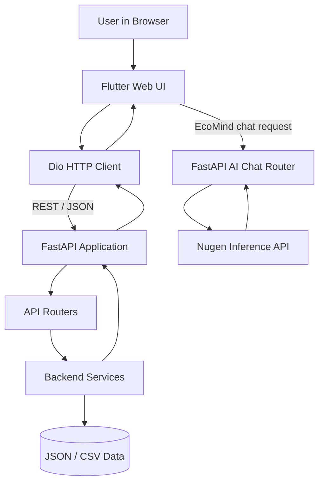

# Ecosystem Rewind

### Intelligent Ecological Restoration Decision-Support Platform  
**A PRITHVI LABS initiative**

[](https://flutter.dev)
[](https://fastapi.tiangolo.com)
[](https://networkx.org)
[](https://nugen.in)

Ecosystem Rewind is a web-based ecological decision-support workbench. It combines ecosystem health indicators, species interaction networks, ecological cascade simulations, restoration recommendations, scenario exploration, habitat suitability information, and an AI ecological assistant.

> **Project status:** The core Flutter + FastAPI application and Nugen-backed text chat are implemented. Image-based species identification and autonomous multi-agent workflows are not included as completed capabilities in this version unless separately implemented in the checked-out source.

---

## GitHub repository description

**Suggested short description (GitHub “About” field):**

> A Flutter + FastAPI ecological restoration decision-support platform featuring species interaction networks, ecosystem simulations, habitat insights, restoration planning, and a Nugen-powered AI assistant.

**Suggested topics:**

`flutter` `flutter-web` `fastapi` `python` `dart` `ecology` `biodiversity` `conservation` `ecosystem-restoration` `networkx` `riverpod` `nugen` `environment`

---

## Contents

- [Project goals](#project-goals)
- [Features](#features)
- [How the website works](#how-the-website-works)
- [Technology stack](#technology-stack)
- [Architecture and request flow](#architecture-and-request-flow)
- [Repository structure](#repository-structure)
- [Prerequisites](#prerequisites)
- [Download the project](#download-the-project)
- [Windows setup](#windows-setup)
- [Configure EcoMind AI / Nugen](#configure-ecomind-ai--nugen)
- [Run the application](#run-the-application)
- [Useful commands](#useful-commands)
- [API documentation](#api-documentation)
- [Data, assumptions, and scientific limitations](#data-assumptions-and-scientific-limitations)
- [Troubleshooting](#troubleshooting)
- [Security notes](#security-notes)
- [Contributing](#contributing)
- [License](#license)

---

## Project goals

Ecological restoration decisions often involve many connected factors: habitat quality, biodiversity, species interactions, ecosystem pressures, intervention feasibility, and recovery time. Looking at any one factor in isolation can hide important dependencies.

Ecosystem Rewind provides an interactive environment for exploring those relationships. It is designed for students, conservation practitioners, ecological researchers, restoration planners, and people interested in ecosystem resilience.

The platform is a **decision-support and educational tool**. It does not replace field surveys, expert ecological assessment, regulatory approvals, or site-specific restoration planning.

## Features

### 1. Ecosystem Health Dashboard

- Summarizes selected ecosystem health indicators.
- Displays an aggregate health score and status information.
- Presents indicator categories and environmental pressures.
- Makes data lineage and illustrative-data limitations visible.

### 2. Species Interaction Network

- Visualizes relationships between species and ecological components.
- Supports interactive graph exploration and species inspection.
- Uses NetworkX graph analysis, including centrality and network structure metrics.

### 3. Ecological Domino Simulator

- Lets users explore a hypothetical removal of a species or ecosystem component.
- Calculates direct and downstream network effects using the modeled interaction graph.
- Compares the baseline graph with the simulated result.

The simulator is a model-based scenario, not a prediction that a real-world extinction cascade will occur exactly as shown.

### 4. Restoration Recommendation Engine

- Ranks restoration actions against modeled ecosystem needs.
- Supports budget-based filtering.
- Uses transparent, rule-based scoring rather than presenting its rankings as an unexplained AI decision.

Recommendations are starting points for investigation. Site conditions, native species, land tenure, local communities, permits, and expert advice must be considered before real interventions.

### 5. Restoration Time Machine

- Compares illustrative baseline and restoration scenarios across future time horizons.
- Displays modeled indicator trajectories and intervention effects.
- Exposes assumptions behind the deterministic scenario calculations.

The projections are exploratory scenarios, not validated forecasts.

### 6. Teak Habitat Suitability

The project includes an exploratory habitat-suitability view for teak (*Tectona grandis*) using a Random Forest presence-background model and mapped forest cells.

Important interpretation notes:

- Scores are **relative habitat suitability indices**, not calibrated probabilities of teak occurrence.
- GBIF occurrence records are presence-only; background points are not confirmed absences.
- The model should not be interpreted as proof that teak is present at a particular location.
- Results require field verification and careful interpretation of sampling bias and input-data limitations.

### 7. EcoMind AI ecological assistant

EcoMind AI is a chat assistant connected through the FastAPI backend to a deployed Nugen-aligned language model.

- Accepts text questions about ecosystems, biodiversity, habitat threats, restoration, and conservation.
- Uses the configured Nugen model for inference.
- Displays generated answers in the Flutter chat interface, including Markdown formatting.

The AI may make mistakes. Verify important ecological claims with trusted scientific sources and qualified local experts. Do not treat a generated answer as a confirmed species observation or a substitute for field identification.

**Not included as a confirmed capability in this setup:** image-based species identification and autonomous multi-agent execution. These require additional vision-model and agent integrations.

---

## How the website works

1. The user opens the Flutter Web application in a browser.
2. The user selects an ecosystem/study area.
3. Flutter displays the workspace pages and reads data from the FastAPI REST API.
4. The backend loads the project's structured data and calls the relevant analytical service.
5. Services calculate graph metrics, health summaries, simulations, recommendations, and scenario outputs.
6. Flutter renders the returned data as dashboards, graphs, maps, and interactive controls.
7. When the user sends a message in EcoMind AI, Flutter sends it to `POST /api/ai/chat`.
8. FastAPI calls the configured Nugen inference endpoint using the API key and model ID stored in environment variables, then returns the generated answer to Flutter.

The frontend and backend run as two separate local processes during development.

## Technology stack

| Layer | Technology | Purpose |
|---|---|---|
| Frontend | Flutter Web / Dart | Responsive browser application |
| State management | Riverpod | Shared and reactive application state |
| Navigation | GoRouter | Workspace and feature routes |
| HTTP | Dio | REST API communication |
| Charts | fl_chart | Indicator and scenario visualizations |
| Maps | flutter_map, latlong2 | Geographic views |
| Backend | FastAPI | Asynchronous REST API |
| Validation/configuration | Pydantic, pydantic-settings | Request validation and environment configuration |
| Graph analysis | NetworkX | Species network metrics and graph simulations |
| Data processing | Pandas | Tabular data processing |
| Image utilities | Pillow, python-multipart | Image file handling dependencies; not, by themselves, a species-identification model |
| AI inference | Nugen API | Nugen-aligned text-model inference for EcoMind AI |

---

## Architecture and request flow



Default local development ports:

- Flutter Web: `3000`
- FastAPI: `8000`

---

## Repository structure

The exact contents can evolve. The main folders are:

```text
Ecosystem-Rewind/
├── .env.example                 # Safe environment-variable template (if included)
├── .gitignore
├── README.md
├── backend/
│   ├── app/
│   │   ├── api/                 # FastAPI route handlers
│   │   ├── config.py             # Environment-based configuration
│   │   ├── data/                 # JSON ecosystem datasets
│   │   ├── schemas/              # Pydantic schemas
│   │   ├── services/             # Ecological and AI services
│   │   └── main.py               # FastAPI application
│   ├── requirements.txt
│   └── venv/                     # Local virtual environment; do not commit
└── frontend/
    ├── lib/
    │   ├── core/                 # App configuration, theme, networking
    │   ├── features/             # Landing, dashboard, network, chat, etc.
    │   ├── models/
    │   ├── providers/
    │   ├── repositories/
    │   └── shared/
    ├── test/
    └── pubspec.yaml
```

Generated folders such as `frontend/build/`, `.dart_tool/`, and Python `__pycache__/` are recreated by the tools and should not be manually downloaded or committed.

---

## Prerequisites

Install these programs before running the project.

### Required

1. **Git** — to clone the repository.  
   Download: https://git-scm.com/downloads

2. **Python 3.12 (64-bit recommended)** — to run the FastAPI backend.  
   Download: https://www.python.org/downloads/

   During Windows installation, enable **“Add Python to PATH”** if the installer offers that option.

3. **Flutter SDK (stable)** — to build and run the frontend.  
   Install guide: https://docs.flutter.dev/get-started/install

4. **Google Chrome** — used by the Flutter Web run command.  
   Download: https://www.google.com/chrome/

5. **Visual Studio Code** (recommended, not mandatory).  
   Download: https://code.visualstudio.com/

### Verify installations

Open PowerShell and run:

```powershell
git --version
python --version
py --version
flutter --version
flutter doctor
```

If `flutter` is not recognized, install Flutter and add its `bin` directory to your Windows `PATH`, then restart the terminal.

---

## Download the project

### Option A — Clone with Git (recommended)

Open PowerShell in the folder where you want the project and run:

```powershell
git clone https://github.com/YOUR-USERNAME/YOUR-REPOSITORY.git
cd YOUR-REPOSITORY
```

Replace the URL with the actual GitHub repository URL after publishing the project.

### Option B — Download ZIP from GitHub

1. Open the GitHub repository page.
2. Click the green **Code** button.
3. Select **Download ZIP**.
4. Extract the ZIP file.
5. Open the extracted project folder in VS Code.

You do not need to download Python packages, Flutter packages, virtual environments, or build outputs manually. The commands below download/install the dependencies from the project's dependency files.

---

## Windows setup

Run the commands from the **project root** unless a step says otherwise.

Example project location:

```text
C:\Users\YOUR-NAME\Desktop\Ecosystem-Rewind
```

Open PowerShell in that folder:

```powershell
cd "C:\path\to\Ecosystem-Rewind"
```

### 1. Set up the backend virtual environment

This project uses a backend-specific virtual environment at `backend\venv`. Use it consistently. Do not accidentally activate a different `venv` at the repository root.

Create it if it does not already exist:

```powershell
py -3.12 -m venv backend\venv
```

Activate it:

```powershell
.\backend\venv\Scripts\Activate.ps1
```

If PowerShell blocks activation, you can either allow scripts for the current PowerShell process:

```powershell
Set-ExecutionPolicy -Scope Process -ExecutionPolicy Bypass
.\backend\venv\Scripts\Activate.ps1
```

Or skip activation and use the virtual environment's Python executable directly in every backend command:

```powershell
.\backend\venv\Scripts\python.exe -m pip install -r backend\requirements.txt
```

Install backend dependencies:

```powershell
python -m pip install --upgrade pip
python -m pip install -r backend\requirements.txt
```

If you did not activate the environment, use:

```powershell
.\backend\venv\Scripts\python.exe -m pip install --upgrade pip
.\backend\venv\Scripts\python.exe -m pip install -r backend\requirements.txt
```

### 2. Configure environment variables for EcoMind AI

The backend can run without Nugen credentials for non-AI features. To use EcoMind AI, you need your own Nugen account, a deployed model, and an API key.

At the **repository root**, create a file named `.env`:

```text
Ecosystem-Rewind/
├── .env
├── backend/
└── frontend/
```

Add the following template, replacing the placeholders with your own Nugen credentials:

```env
NUGEN_API_KEY=YOUR_NUGEN_API_KEY
NUGEN_MODEL_ID=YOUR_DEPLOYED_NUGEN_MODEL_ID
NUGEN_API_URL=https://api.nugen.in/api/v3/inference/chat/completions
```

Do not add quotation marks unless your configuration specifically requires them. Do not share your API key or commit `.env` to GitHub.

The repository's `.gitignore` should exclude `.env`. If it does not, add:

```gitignore
.env
.env.*
!.env.example
```

You may create a shareable `.env.example` containing only placeholder values:

```env
NUGEN_API_KEY=replace_with_your_key
NUGEN_MODEL_ID=replace_with_your_deployed_model_id
NUGEN_API_URL=https://api.nugen.in/api/v3/inference/chat/completions
```

### 3. Set up the Flutter frontend

Open a **second PowerShell terminal**. Keep the backend terminal available.

From the repository root:

```powershell
cd frontend
flutter doctor
flutter pub get
```

`flutter pub get` reads `pubspec.yaml` and downloads the Flutter/Dart packages. You do not need to install each Dart package manually.

Optional quality checks:

```powershell
flutter analyze
flutter test
```

---

## Run the application

You must run the backend and frontend at the same time, in two separate terminals.

### Terminal 1 — Start FastAPI

Open PowerShell at the repository root:

```powershell
cd "C:\path\to\Ecosystem-Rewind"
```

Activate the backend environment:

```powershell
.\backend\venv\Scripts\Activate.ps1
```

Start the API:

```powershell
python -m uvicorn backend.app.main:app --host 127.0.0.1 --port 8000
```

Alternatively, without activating the environment:

```powershell
.\backend\venv\Scripts\python.exe -m uvicorn backend.app.main:app --host 127.0.0.1 --port 8000
```

When successful, Uvicorn reports that the application startup is complete and is listening on port `8000`.

Keep this terminal running.

### Terminal 2 — Start Flutter Web

Open a second PowerShell terminal:

```powershell
cd "C:\path\to\Ecosystem-Rewind\frontend"
```

Fetch packages if this is the first run or dependencies have changed:

```powershell
flutter pub get
```

Run the website in Chrome:

```powershell
flutter run -d chrome --web-port 3000
```

The browser should open the application at:

**http://localhost:3000**

Keep this terminal running too.

### Useful local URLs

| Service | URL |
|---|---|
| Flutter website | http://localhost:3000 |
| FastAPI base | http://127.0.0.1:8000 |
| Swagger / interactive API docs | http://127.0.0.1:8000/docs |
| ReDoc API docs | http://127.0.0.1:8000/redoc |

To stop a server, focus its terminal and press `Ctrl + C`.

---

## Useful commands

### Backend

Run from the repository root with the backend virtual environment activated:

```powershell
# Install/update backend packages
python -m pip install -r backend\requirements.txt

# Start the backend with auto-reload for development
python -m uvicorn backend.app.main:app --reload --host 127.0.0.1 --port 8000

# Run backend tests (if the test suite is present)
python -m pytest -v
```

### Frontend

Run from the `frontend` directory:

```powershell
# Download Flutter dependencies
flutter pub get

# Check code quality
flutter analyze

# Run Flutter tests
flutter test

# Start the web application
flutter run -d chrome --web-port 3000

# Build an optimized web release
flutter build web --release
```

The production web files are generated in:

```text
frontend/build/web/
```

### Git

Run from the repository root:

```powershell
git status
git add .
git commit -m "Update Ecosystem Rewind"
git push
```

Before `git add .`, confirm that `.env`, API keys, private datasets, virtual environments, and other secrets are excluded by `.gitignore`.

---

## API documentation

FastAPI automatically generates interactive API documentation when the backend is running:

- Swagger UI: http://127.0.0.1:8000/docs
- ReDoc: http://127.0.0.1:8000/redoc

The application includes feature APIs for ecosystem areas, health indicators, species networks, simulations, restoration recommendations, scenarios, and habitat information. The exact route list is available from the running Swagger page.

EcoMind AI chat endpoint:

| Method | Endpoint | Purpose |
|---|---|---|
| `POST` | `/api/ai/chat` | Send a text question to EcoMind AI |

Example request body:

```json
{
  "message": "What are practical ways to restore a degraded forest?"
}
```

The endpoint uses the Nugen model configured in the backend environment. The API key must remain on the backend; never put it in Flutter code or browser-visible configuration.

---

## Data, assumptions, and scientific limitations

- Some ecosystem data included in the project are illustrative demonstration datasets. They are not a live, exhaustive biodiversity census.
- Species interaction graphs represent modeled relationships and should not be interpreted as complete field-verified food webs.
- Domino simulations are conditional on the graph and assumptions supplied to the model.
- Restoration recommendations are rule-based decision-support outputs and require local review.
- Time Machine trajectories are deterministic exploratory scenarios, not validated ecological forecasts.
- Teak habitat suitability values are relative model scores, not calibrated occurrence probabilities. Background records are not confirmed absences, and field verification is required.
- EcoMind AI responses are generated by a language model and may contain errors. Verify important claims with primary scientific literature, local datasets, and qualified experts.
- A successful AI response does not prove that a species occurs at a location.

---

## Troubleshooting

### `python` or `py` is not recognized

Install Python and enable PATH integration, then restart PowerShell. Check:

```powershell
python --version
py --version
```

### `No module named pydantic_settings`

The server is likely running from the wrong Python environment. From the repository root, use the backend environment explicitly:

```powershell
.\backend\venv\Scripts\python.exe -m pip install -r backend\requirements.txt
.\backend\venv\Scripts\python.exe -m uvicorn backend.app.main:app --host 127.0.0.1 --port 8000
```

Do not rely only on the terminal's `(venv)` label; multiple virtual environments can have the same name. Check the actual interpreter:

```powershell
.\backend\venv\Scripts\python.exe -c "import sys; print(sys.executable)"
```

### `No module named ...`

Install dependencies into the backend environment:

```powershell
.\backend\venv\Scripts\python.exe -m pip install -r backend\requirements.txt
```

### Flutter command is not recognized

Install Flutter, add Flutter's `bin` directory to PATH, restart the terminal, and check:

```powershell
flutter doctor
```

### `flutter pub get` fails

Check the Flutter/Dart installation and internet connection:

```powershell
flutter --version
flutter doctor -v
```

Then retry:

```powershell
cd frontend
flutter pub get
```

### Port 8000 or 3000 is already in use

Stop the previous process with `Ctrl + C` in its terminal. Alternatively, choose another port and update the frontend API base URL to match the backend host and port.

### EcoMind AI returns a configuration error

Check that:

- `.env` is in the repository root.
- `NUGEN_API_KEY` contains a valid, active API key.
- `NUGEN_MODEL_ID` matches a deployed model.
- The Nugen endpoint URL is correct.
- The backend was started from the repository root so the root `.env` can be loaded.

Never paste your API key into an issue, screenshot, chat, or public repository.

### Flutter chat cannot reach FastAPI

Make sure FastAPI is running and that the frontend API base URL points to the backend. The default local frontend configuration in this project uses:

```text
http://127.0.0.1:8000/api
```

For a browser running on a different device, `127.0.0.1` refers to that device itself; configure a reachable backend host and appropriate CORS settings.

---

## Security notes

- Never commit `.env`, API keys, tokens, passwords, or private credentials.
- Keep Nugen credentials on the backend. Do not embed them in Flutter source code.
- Use HTTPS, restrictive CORS origins, request limits, and appropriate authentication before exposing the API publicly.
- Review licenses and permissions for datasets, map tiles, and third-party services before public or commercial deployment.
- Do not upload sensitive personal information or confidential field data to external AI services unless you have authorization.

## Contributing

Contributions, bug reports, and suggestions are welcome.

1. Fork the repository.
2. Create a feature branch.
3. Make a focused change.
4. Run the relevant checks (`flutter analyze`, `flutter test`, and backend tests where available).
5. Open a pull request describing the change and its validation.

For ecological data or model changes, include source provenance, assumptions, spatial/temporal coverage, and known limitations.

## License

The original project README identifies this project as **Proprietary / PRITHVI LABS**. Unless the repository owner explicitly changes the license, all rights remain reserved. Do not assume that public visibility on GitHub grants permission to reuse the code, data, or branding.

---

**Developed by PRITHVI LABS**  
*Pioneering computational ecological intelligence.*
